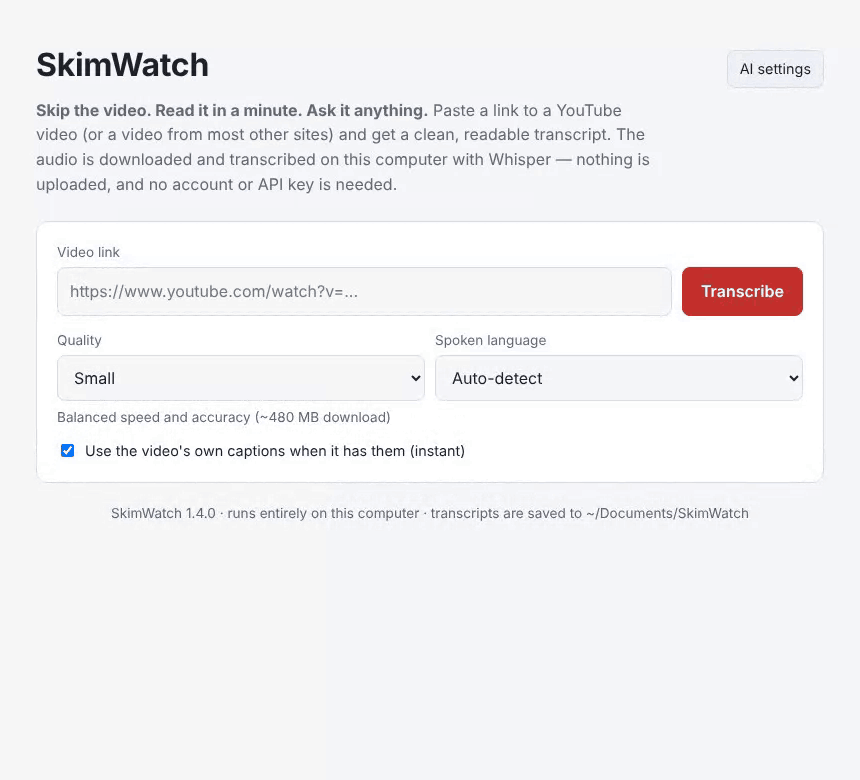

# SkimWatch

**Skip the video. Read it in a minute. Ask it anything.**


[skimwatch.com](https://skimwatch.com) · an [Advance Interactive](https://advanceinteractive.com) project



<sub>Demo with a captioned video (a public-domain reading), so the transcript is
instant. Without captions, Whisper takes about 1½ minutes for a 7-minute video
on an M2 MacBook Pro.</sub>

Paste a link to a YouTube video (or a video from most other sites) and get a
clean, readable transcript — in your browser, on your own computer. Then ask it
questions instead of watching the whole thing.

- **Private.** The audio is downloaded and transcribed locally with
  [Whisper](https://github.com/openai/whisper). Nothing is uploaded, and no
  account or API key is needed.
- **Fast.** If the uploader published captions, you get them instantly and
  nothing is downloaded. Otherwise Whisper transcribes several pieces of
  speech at once on computers with the memory for it (about 1.7x faster).
- **Ask questions (optional).** Connect Claude, ChatGPT or a local Ollama
  model to summarise a transcript or answer questions about it.
- **Simple.** Double-click one file to start. A page opens in your browser;
  paste a link and press **Transcribe**.
- **Readable.** The text is grouped into paragraphs, with optional timestamps,
  a copy button, and `.txt` / `.srt` (subtitle) downloads.
- **Works on macOS, Windows and Linux.** No separate ffmpeg, Node or other
  tools to install.


## Quick start

### Mac app (no Python needed)

1. Download `SkimWatch-<version>-mac-arm64.zip` from the
   [Releases](../../releases) page and unzip it. It needs an Apple Silicon
   Mac (M1 or newer) running **macOS 14 Sonoma or later**. Not sure? Open the
   Apple menu → **About This Mac**; it shows both. Intel Macs and older
   macOS versions can run from source instead (next section).
2. Drag **SkimWatch** to your Applications folder and open it. Everything
   it needs is inside the app; nothing else to install.
3. The app is not signed with a paid Apple certificate, so macOS blocks it the
   first time. Open **System Settings → Privacy & Security**, scroll down, and
   click **Open Anyway**. (On macOS 14 and earlier: right-click the app and
   choose **Open**.) You only do this once.
4. Your browser opens the app's page. Paste a video link and press
   **Transcribe**.

Click the Dock icon to bring the page back; quit from the Dock or with
`Cmd+Q`. Transcripts are saved to `Documents/SkimWatch`.

### Run from source (macOS, Windows, Linux)

You need **Python 3.10 or newer** ([python.org/downloads](https://www.python.org/downloads/)).
On Windows, tick **"Add python.exe to PATH"** in the installer.

1. Download this project (green **Code** button → **Download ZIP**) and unzip it.
2. Start it:
   - **macOS:** double-click `start-mac.command`. If macOS blocks it, approve
     it under **System Settings → Privacy & Security → Open Anyway**.
   - **Windows:** double-click `start-windows.bat`.
     If SmartScreen appears, choose **More info → Run anyway**.
   - **Linux:** run `./start-mac.command` in a terminal.
3. Your browser opens at `http://127.0.0.1:8765/`. Paste a video link and press
   **Transcribe**.

The first start takes a few minutes while it installs what it needs into a
private `.venv` folder inside the project, including a copy of
[Deno](https://deno.com/), which the downloader uses for YouTube links.
Nothing is installed anywhere else on your computer. To stop the program,
close its terminal window or press `Ctrl+C` in it.

### Either way

The first time you use each quality level, its speech model is downloaded
once. After that, transcription itself works offline (the video still has to
be downloaded).

## Quality levels

| Quality    | Download | Notes                                          |
|------------|----------|------------------------------------------------|
| `tiny`     | ~75 MB   | Fastest, rough accuracy                        |
| `base`     | ~145 MB  | Fast, decent accuracy (default)                |
| `small`    | ~480 MB  | Balanced speed and accuracy                    |
| `medium`   | ~1.5 GB  | Slow, very good accuracy                       |
| `turbo`    | ~1.6 GB  | Near-best accuracy, far faster than `large-v3` |
| `large-v3` | ~3 GB    | Slowest, best accuracy                         |

As a rough guide, on an M2 MacBook Pro `small` turns a 7-minute video into
text in about 1½ minutes, download included. Bigger models and older
computers are slower; videos with their own captions are near-instant.

The spoken language is detected automatically. If a video starts with music or
switches language, pick the language yourself for a better result.

**Captions first.** When **Use the video's own captions** is ticked (the
default) and the uploader published captions in the video's language (or the
one you picked), SkimWatch uses those: the transcript appears in a second or
two, nothing is downloaded, and the page notes "from the video's own
captions". Automatic captions that YouTube generates itself are not used,
since Whisper does better. Untick the box to always use Whisper.

**Batching.** On a computer with at least 4 cores and 8 GB of memory, Whisper
transcribes several pieces of speech at once: on an M2 MacBook Pro a 7-minute
video took 1:30 instead of 2:31, download included. Text then appears a
section (up to 10 minutes of video) at a time rather than line by line.
Smaller computers work one piece at a time, as do the biggest quality levels
when memory is tight. To choose yourself, set `SKIMWATCH_BATCH_SIZE` before
starting (`1` means one at a time).

## Ask questions about a transcript (optional)

Click **AI settings** at the top of the page (or **Set up AI assistant** under a
finished transcript), choose an assistant, paste your API key and press
**Save**. Then ask for a summary, the key points, or anything else about the
video in the **Ask about this transcript** panel.


| Assistant           | What you need                                                        | Where the text goes        |
|---------------------|----------------------------------------------------------------------|----------------------------|
| Claude (Anthropic)  | An API key from [console.anthropic.com](https://console.anthropic.com/) | Sent to Anthropic          |
| ChatGPT (OpenAI)    | An API key from [platform.openai.com](https://platform.openai.com/)  | Sent to OpenAI             |
| Ollama              | [Ollama](https://ollama.com/) installed, with a model pulled         | Stays on this computer     |

This is the one feature that can send text off your computer, and only when
you set it up and ask a question: the transcript and your questions go to the
assistant you chose, and usage is billed to your own API key. Choose Ollama to
keep everything local and free. Transcribing never uses any of these.

Your key is stored only on this computer, in `~/.skimwatch/settings.json`
(readable only by you), and is never shown again in the page. Under
**Advanced** you can point the ChatGPT option at any OpenAI-compatible service.

## Share with your family (phones included)

You can let people who don't live with you use your copy from their phones.
The program keeps running on your computer at home, so YouTube links work, and
they reach it through a private web address protected by an access code.

1. **Start sharing.** Double-click `share-mac.command` (or run
   `python webapp.py --share`). It prints an **access code** such as
   `KQ7M-2XDF` and keeps the Mac awake while it runs.
2. **Open a tunnel** from the internet to the program. Either:
   - **[Tailscale](https://tailscale.com/) Funnel** (free; the address stays
     the same): install Tailscale, sign in, then run `tailscale funnel 8765`.
     It shows an address like `https://your-mac.your-name.ts.net`.
   - **[Cloudflare](https://developers.cloudflare.com/cloudflare-one/connections/connect-networks/) quick tunnel**
     (free, no account; the address changes every time you start it):
     `cloudflared tunnel --url http://127.0.0.1:8765`.
3. **Send your family the address and the access code.** They open the
   address, type the code once, and can then paste video links. On an iPhone,
   **Share → Add to Home Screen** makes it open like an app.

Good to know:

- Your computer must be on, awake and running both the program and the tunnel.
- It transcribes one video at a time; others wait their turn. Videos
  visitors paste can be up to 3 hours long, so one stray link can't tie up
  your computer for a day (videos with their own captions are exempt, since
  they take no work); you have no limit when using it yourself.
- Visitors can transcribe. They can also ask the AI assistant questions if you
  tick **Let people I share with ask questions too** in **AI settings** (off by
  default; their questions are billed to your key). They cannot see or change
  your settings, your API key, or where files are stored, and they cannot submit
  links to addresses on your home network. Their transcripts are also saved in
  your transcripts folder.
- Anyone with both the address and the code can use it. To lock everyone out
  and get a new code, run `python webapp.py --share --new-share-code`. Ten
  wrong codes in 15 minutes from one visitor pauses sign-in for that visitor
  for 15 minutes; one person mistyping does not lock out the others.
- Sharing is available when running from source, not in the packaged Mac app.

## Where transcripts go

Every finished transcript is also saved as `<title>_<video id>.txt` and `.srt`:
in `Documents/SkimWatch` for the Mac app, or in the `transcripts` folder
next to the program when run from source. **Show in folder** on the page opens
it.

## Command line

The same engine works without the browser:

```
python local_transcribe.py "https://www.youtube.com/watch?v=..." --model small
python local_transcribe.py "<url>" --language es --out ~/Desktop/transcripts --keep-audio
python local_transcribe.py "<url>" --no-captions    # always use Whisper
```

Run it with the Python inside `.venv` (`.venv/bin/python` on macOS/Linux,
`.venv\Scripts\python` on Windows), or install the requirements yourself with
`pip install -r requirements.txt`.

Web app options: `python webapp.py --port 9000 --no-browser --out <folder>`.

## Troubleshooting

- **"Could not download that video"** — sites change often, and the downloader
  ([yt-dlp](https://github.com/yt-dlp/yt-dlp)) is updated to keep up.
  - *Mac app:* download the latest release; each one ships the current
    downloader.
  - *From source:* `.venv/bin/python -m pip install -U yt-dlp` (Windows:
    `.venv\Scripts\python -m pip install -U yt-dlp`).
- **"YouTube links need Deno"** — YouTube makes the downloader solve small
  JavaScript puzzles, which needs [Deno](https://deno.com/). The Mac app
  includes it, and the start scripts download it into `.venv`. If that
  download was blocked, install Deno yourself (one command on its website)
  and start SkimWatch again; the program's window says
  `YouTube support: ready` once it is found.
- **Private, members-only, age-restricted or login-only videos** are not
  supported. Some sites (Vimeo, for example) require a login for most videos.
- **"That is a live stream"** — live streams can be transcribed once they
  have ended.
- **A playlist link** transcribes the first video only. Paste the link of the
  individual video you want.
- **The page doesn't open** — look in the program's window for the address; if
  port 8765 is busy it uses the next free one.

## How it works

- `local_transcribe.py` — the engine and command-line tool: downloads the
  audio with yt-dlp, transcribes it with
  [faster-whisper](https://github.com/SYSTRAN/faster-whisper), and formats the
  result.
- `webapp.py` — a small web server (Python standard library only) that answers
  on `127.0.0.1` only, so nothing else on your network can reach it.
- `web/index.html` — the page you see.
- `ai_chat.py` — the optional connection to Claude, OpenAI or Ollama.
- `web/login.html`, `share-mac.command` — the access-code page and launcher for
  family sharing.
- `app.py` — entry point of the packaged app (Dock icon, single instance).
- `packaging/` — the Mac app build, pinned Deno version and checksums, and
  the generator for the third-party notices.
- `tests/` — run with `python -m unittest discover -s tests`.

## Building the Mac app

```
./packaging/build-mac.sh
```

This uses [PyInstaller](https://pyinstaller.org/) in a throw-away environment
and writes `dist/SkimWatch-<version>-mac-<arch>.zip`. It downloads the Deno
release pinned in `packaging/deno-version.txt`, checks it against
`packaging/deno-sha256.txt`, and bundles it with the app. To move to a newer
Deno, update both files. The app runs only on the kind of Mac it was built on
(Apple Silicon or Intel). Upload the zip to a GitHub release to share it.

## Responsible use

SkimWatch is a tool; you are responsible for how you use it.

- **Site terms.** Many sites, YouTube included, do not allow downloading
  except through their own download features or with permission, and do not
  allow automated access. Using this program on such a site may break its
  terms of service, and the site may block or rate-limit you.
- **Copyright.** A transcript is a copy of someone's words. Transcribing your
  own videos, public-domain or Creative Commons material, or videos you have
  permission to use is the safe case. Keeping a private transcript to study,
  quote briefly or make a video accessible may be allowed where you live (for
  example as fair use in the US), but publishing or selling transcripts of
  other people's videos generally needs their permission.
- **Accuracy.** Transcripts are machine-generated and will contain mistakes;
  check anything important against the original.

This is general information, not legal advice. This project is not affiliated
with or endorsed by YouTube or Google; "YouTube" is a trademark of Google LLC.

## Contributing and security

See [CONTRIBUTING.md](CONTRIBUTING.md). Please report security issues privately
as described in [SECURITY.md](SECURITY.md).

## License

[MIT](LICENSE) © 2026 Advance Interactive (SQLPRO LLC)

The source code in this repository is MIT licensed.

The **Mac app download** also contains third-party libraries, listed with
their licenses and source links in `THIRD_PARTY_NOTICES.txt` inside the app
(`Contents/Resources`). Two of them, the x264 and x265 encoders that come with
the audio library's FFmpeg build, are GPL licensed. The Mac app is therefore
distributed under the terms of the GNU GPL version 2 or later as a combined
work, while the source code of SkimWatch itself stays MIT. This changes
nothing for people who use the app or run it from source.
